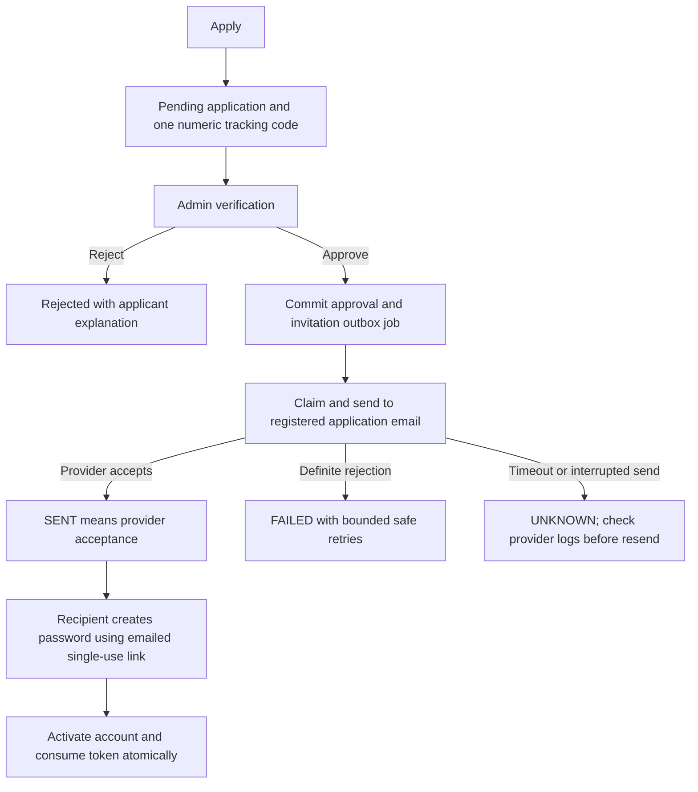

# Email delivery: Brevo HTTPS, Gmail SMTP and development

Provider selection is server-only. The November 4 membership redesign adds database migrations for numeric tracking, a durable invitation outbox and attempt auditing. See [the current engineering report](membership-email-tracking.md) for confirmed failures, implementation, verification and deployment steps. Earlier verification entries below describe the implementation at their stated dates.

`EMAIL_PROVIDER=brevo|smtp|development` selects the sender explicitly. If it is unset or empty, the existing `ACTIVATION_DELIVERY=smtp|development` setting is used. `ACTIVATION_DELIVERY=brevo` is not valid. Explicit selection takes precedence when both are set. Restart/redeploy the backend after changing variables.

The shared sender preserves existing subjects and plain-text templates and supplies HTML with escaped text and clickable HTTPS links. Callers can also supply existing HTML explicitly. SMTP retains verified TLS/mandatory STARTTLS and its existing timeouts. Brevo uses Node's built-in `fetch` with a fixed HTTPS endpoint, a 10-second deadline and redirects disabled. Provider response bodies and credentials are neither logged nor returned.

## Existing workflows inspected

| Workflow | Existing behavior after integration |
| --- | --- |
| Membership application confirmation | One numeric tracking code in the submission response/UI. Email ownership verification is required to view private tracking details. No separate application-confirmation email is sent. |
| Membership approval and activation | Admin approval commits a hashed 48-hour, single-use invitation and an outbox job atomically. Delivery attempts record safe outcomes; approval persists on failure. Admin can resend after a cooldown; no Admin response contains an activation link. |
| Admin invitations | SuperAdmin-only invitation, existing delivered-token requirement, 48-hour expiry and single-use activation remain in place. |
| Password recovery | Same public response, eligibility/approval rules, 30-minute single-use token, delivery tracking and session invalidation. Failed delivery removes the undelivered token. |
| Email verification | Existing email-change verification, current-password check, reserved address, 30-minute expiry and single-use consumption remain. Email stays unchanged until verification succeeds. Failed delivery removes the pending reservation. |
| Document request confirmation | Submission response and existing request tracking only. **No existing confirmation email or template; none added.** |

`development` returns no invitation links. Without an explicitly configured local catcher it records `EMAIL_NOT_CONFIGURED`. With `DEVELOPMENT_MAIL_CAPTURE=true`, a loopback SMTP host and the platform email switch enabled, mail is captured locally; this does not mean external delivery. Production startup rejects development mail and loopback frontend URLs.

## Membership delivery flow



The tracking code is permanent across approval, retry, resend and activation. It is not an authentication credential. Tracking requires a six-digit code sent to the registered email, then uses a private 30-minute proof held only in page memory. Existing reference/secret receipts still work; lost numeric codes can be recovered through email verification. Activation links appear only in private mail, never in Admin or public tracking responses.

## Gmail SMTP locally

Set these only in `backend/.env`:

```dotenv
EMAIL_PROVIDER=smtp
SMTP_HOST=smtp.gmail.com
SMTP_PORT=465
SMTP_SECURE=true
SMTP_FROM=your-address@gmail.com
SMTP_USER=your-address@gmail.com
SMTP_PASSWORD=your-google-app-password
```

`SMTP_PASSWORD` is a Google app password, not the normal account password. The existing SMTP variables are `SMTP_HOST`, `SMTP_PORT`, `SMTP_SECURE`, `SMTP_FROM`, `SMTP_USER` and `SMTP_PASSWORD`; legacy provider selection uses `ACTIVATION_DELIVERY`. Port 587 with `SMTP_SECURE=false` requires STARTTLS. For a deliberately trusted relay, the username/password may both be omitted; a half-configured pair is rejected when SMTP is selected.

Then enable **email delivery** in **SuperAdmin → Platform settings**. `npm --prefix backend run smtp:check` verifies SMTP connectivity/authentication without sending a message. Do not put credentials in frontend variables or Git.

## Brevo on Railway

Set these in the **backend service's Variables**:

```dotenv
EMAIL_PROVIDER=brevo
BREVO_API_KEY=your-private-brevo-api-key
BREVO_SENDER_EMAIL=registrar@your-verified-domain.example
BREVO_SENDER_NAME=Gray D. Allison Alumni Portal
```

All three Brevo variables are required when Brevo is selected. Use a Brevo API key, not its SMTP key. Verify the sender/domain in Brevo. Keep the existing production `NODE_ENV`, `DATABASE_URL`, random `JWT_SECRET`, HTTPS `FRONTEND_ORIGIN`, proxy and storage configuration. Gmail credentials are not required by Brevo. Remove unused SMTP variables from the Railway service if desired; leave them in local `.env` for local SMTP. Do not change credentials locally as a way to configure Railway.

Redeploy the backend, check `/api/ready`, then enable **email delivery** in **SuperAdmin → Platform settings**, confirming with the existing SuperAdmin password. Settings expose only provider/configuration status and sender address; they do not establish provider health or inbox delivery. This implementation does not change Railway variables. The separately authorized live diagnostic is recorded below.

## Tests and diagnostics

Mocked tests, without provider access:

```bash
cd backend
NODE_ENV=test EMAIL_PROVIDER= ACTIVATION_DELIVERY=development npm test -- email.test.ts environment.test.ts activation-delivery.test.ts auth.service.test.ts membership.service.test.ts permissions.test.ts
```

For the real database regressions, set `DATABASE_URL` and `PHASE1_TEST_DATABASE_URL` to an isolated local database named `gda_phase1_test`, apply existing migrations, then run:

```bash
npm test -- --no-file-parallelism email-workflows.database.test.ts accounts.database.test.ts membership-delivery.database.test.ts release-features.database.test.ts membership.database.test.ts phase1.integration.test.ts security.integration.test.ts readiness.test.ts
```

The Brevo tests stub `fetch`; SMTP regressions mock Nodemailer. Database tests refuse non-local/non-test databases. Use test-only SMTP settings and development as the fallback provider when running them, as CI does.

The new diagnostic is safe by default:

```bash
npm --prefix backend run email:check
# After npm --prefix backend run build, on Railway:
npm run email:check:production
```

Without flags it only validates local configuration; it makes no network request and sends no message. **Only after the operator confirms the send**, privately configure exactly one `EMAIL_TEST_RECIPIENT`, then use:

```bash
npm --prefix backend run email:check -- --send-test --confirm-send
# Or from the Railway backend service shell:
npm run email:check:production -- --send-test --confirm-send
```

Both flags, a valid test recipient, a real configured provider and the enabled platform switch are required. The message contains no activation/reset token and creates no account or application. No test recipient or credentials are printed. One send is attempted; there are no automatic retries. On 4 November 2026, Gmail accepted one separately authorized, token-free SMTP transport diagnostic; inbox receipt remains unconfirmed. The application-guarded diagnostic stopped at the disabled email switch before sending. See the [membership delivery report](membership-email-tracking.md) for the audit, final validation and remaining rollout steps.

## Reliability and scheduling

Membership invitations use a transactional outbox, atomic claim, attempt history, bounded exponential backoff and a resend cooldown. Tokens are derived with HMAC from a random job ID and a server-only secret; only hashes are persisted. Retries reuse the event and message. Brevo receives the existing deterministic idempotency key; its duplicate window is 30 minutes. SMTP has no exactly-once send guarantee, so ambiguous failures are marked `UNKNOWN` and are not automatically resent. After inspecting provider logs, an Admin can issue a replacement which invalidates the previous token.

Long-running `server.ts` runs a bounded worker every 15 seconds. The worker command is `npm --prefix backend run invitations:process`; hosted built code uses `npm run invitations:process:production`. Serverless deployments require an authenticated scheduler calling `GET /api/cron/invitations` with `Authorization: Bearer <CRON_SECRET>` every minute. The existing daily maintenance call also processes one job but does not provide timely retries. No scheduler is installed on a hosting account by these source changes.

Provider acceptance does not establish inbox placement. Inspect transactional logs for delivery, deferral, bounces, blocked/suppressed recipients and rejection events. Webhooks are not installed, so the portal never claims confirmed external delivery. Password-reset, Admin-invitation and email-change workflows continue using the shared sender and their existing token behavior; the new durable outbox applies to membership invitations.

API contract: [Brevo transactional email reference](https://developers.brevo.com/reference/send-transac-email). Duplicate suppression: [Brevo idempotency documentation](https://developers.brevo.com/docs/heterogenous-versions-batch-emails).

## Implementation files and validation

| Files | Change |
| --- | --- |
| `backend/src/config/email.ts`, `backend/src/config/env.ts` | Provider precedence, required Brevo configuration and legacy SMTP compatibility. |
| `backend/src/services/email.service.ts` | Shared HTTPS/SMTP transport, HTML/plain text, sanitized failures, timeout and Brevo idempotency. |
| `backend/src/services/account-mail.service.ts`, `activation-delivery.service.ts` | Existing mail entry points use the selected sender and existing platform switch. |
| `backend/src/services/account.service.ts`, `password-reset.service.ts`, `platform.service.ts` | Existing token events supply stable delivery keys; platform settings report the selected provider safely. |
| `backend/src/controllers/health.controller.ts` | Configured Brevo satisfies production delivery readiness. |
| `backend/scripts/check-email.ts`, `check-smtp.ts`, `backend/package.json` | Safe configuration diagnostic, explicitly guarded test-send command and provider-aware SMTP check. |
| `backend/.env.example` | Server-only development, Gmail and Brevo examples. |
| `backend/src/__tests__/email.test.ts`, `email-workflows.database.test.ts`, `environment.test.ts`, `readiness.test.ts` | Mocked provider failures/success, selection, guarded diagnostics and real PostgreSQL token/authentication regressions. |
| `frontend/src/views/SuperAdminView.vue` | Provider-neutral configuration help text. No credentials added to the frontend. |
| `README.md`, `DEPLOYMENT.md`, `docs/vercel-backend.md`, `docs/release-verification.md`, this document | Setup, compatibility, workflow gaps and diagnostic instructions. |

Verification on 28 October 2026: backend TypeScript/runtime build passed; **76 focused tests** and **53 database-backed/API regression tests** passed (129 total, 14 test files). The latter used a freshly migrated temporary PostgreSQL 16 cluster, test-only configuration and mocked mail. The safe diagnostic reported the existing local SMTP selection and sent no network request or email. No dependencies or email-related schema migrations were added. Brevo credentials were absent locally; deployed provider access, sender verification and real inbox delivery were not tested. Local checks ran on the available Node 20.20.2 runtime; the repository still requires Node 22.13 or newer for deployment (`.nvmrc` selects Node 22).

Recheck on 3 November 2026: all **129 tests across those 14 files passed again**, using a freshly migrated, isolated PostgreSQL 16 database and mocked Brevo/SMTP. Coverage includes successful delivery, sanitized provider failures, duplicate suppression, approval retention after failed delivery, reissue, single-use activation, role restrictions, password recovery, old-session invalidation and email-change verification. The read-only diagnostic detected the locally configured Brevo provider and required variables. It made no provider request and sent no email; provider access, sender verification and inbox delivery remain unverified. Browser test servers now explicitly override the local email provider with development delivery or the SMTP fixture and clear Brevo credentials.

The complete backend suite subsequently passed on Node 22.23.4: **240 tests across 34 files**, including all email/authentication suites. The release browser suite also passed all **5 tests**, including a reset email captured in the local SMTP fixture, single-use redemption, password update and invalidation of existing browser sessions. This verifies the application flow without proving real provider acceptance or inbox placement.


## Read-only provider check and local mail capture

Use `npm --prefix backend run email:check -- --verify-provider` to inspect the email switch and Brevo account/sender authorization or SMTP connection/authentication. It sends no message and exposes no credentials or recipient addresses. A successful check still does not prove inbox delivery.

For a private local Mailpit instance, bind both its SMTP and web interface to loopback. For example, with Docker available:

```bash
docker run --rm --name gda-mailpit -p 127.0.0.1:1025:1025 -p 127.0.0.1:8025:8025 axllent/mailpit
```

Configure development backend variables (never production):

```dotenv
EMAIL_PROVIDER=development
DEVELOPMENT_MAIL_CAPTURE=true
SMTP_HOST=127.0.0.1
SMTP_PORT=1025
SMTP_FROM=portal@example.test
```

Enable the platform email switch in the intended development database, restart the API, and view captured messages at `http://127.0.0.1:8025`. Plaintext SMTP is allowed only for this explicit loopback capture path. Real Brevo/SMTP transports retain TLS verification. Keep the catcher private: it contains personal invitations and verification codes. No external recipient receives these captured messages.
